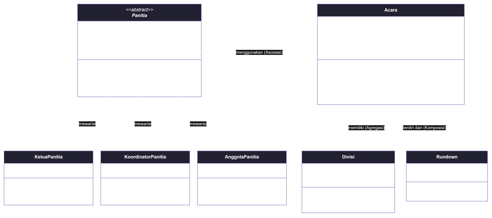

# Sistem Manajemen Kepanitiaan dan Pelaksanaan MIT-WEEK 2025

| Informasi | Detail |
|---|---|
| Nama | Muhammad Zidane Abdul Kadir |
| NIM | 2509106021 |
| Praktikum | Pemrograman Berorientasi Objek (Posttest 3 - Polimorfisme & Abstraksi) |

## Deskripsi Singkat Program

Program CLI ini mengelola kepanitiaan, divisi, acara, notifikasi publikasi, dan rundown kegiatan **MIT-WEEK 2025**. Pada tahap ini, sistem dikembangkan untuk menerapkan konsep **Abstraksi (Abstract Base Class)**, **Polimorfisme** (Pewarisan, *Duck Typing*, dan *Operator Overloading*), ketiga **Relasi UML** (Asosiasi, Agregasi, Komposisi), serta prinsip desain **SOLID** (*Open/Closed Principle* dan *Dependency Inversion Principle*).

---

## Class Diagram & Penjelasan Relasi UML



### Penjelasan Relasi Antar Kelas:
1. **Asosiasi (`Panitia` ..> `Acara`):**
   Relasi asosiasi terjadi dari kelas `Panitia` ke kelas `Acara` melalui method `koordinasikan_acara(acara)`. Jenis relasi ini dipilih karena objek `Panitia` hanya menggunakan objek `Acara` sementara sebagai parameter method tanpa menyimpannya sebagai atribut kepemilikan permanen, sehingga kedua objek hidup secara independen.
2. **Agregasi (`Acara` o-- `Divisi`):**
   Relasi agregasi terjadi dari kelas induk `Acara` ke kelas bagian `Divisi` yang disimpan di dalam list `_divisi`. Agregasi dipilih (bukan komposisi) karena objek `Divisi` dibuat secara mandiri di luar `Acara` dan siklus hidupnya tidak bergantung pada `Acara`; jika sebuah acara selesai atau referensi divisi dilepas melalui `lepas_divisi()`, objek `Divisi` tersebut tetap utuh di memori dan dapat bertugas di acara lain.
3. **Komposisi (`Acara` *-- `Rundown`):**
   Relasi komposisi terjadi dari kelas induk `Acara` ke kelas bagian `Rundown` yang disimpan di dalam atribut private `__rundown`. Komposisi dipilih (bukan agregasi) karena objek `Rundown` diinstansiasi secara langsung di dalam method `Acara.tambah_rundown(waktu, kegiatan)` dan tidak memiliki arti mandiri di luar acara tersebut, sehingga jika objek `Acara` dihapus, seluruh daftar `Rundown` di dalamnya ikut musnah.

---

## Penerapan Abstraksi dan Polimorfisme

### 1. Abstraksi (Abstract Base Class)
* **Abstract Class & Abstract Method:** Kelas `Panitia(ABC)` merupakan *abstract base class* yang mendefinisikan kontrak bagi seluruh kepanitiaan melalui dua `@abstractmethod`, yaitu `deskripsi_tugas()` dan `wewenang_khusus()`.
* **Implementasi Subclass:** Tiga subclass, yaitu `KetuaPanitia`, `KoordinatorPanitia`, dan `AnggotaPanitia`, mewarisi `Panitia` (menggunakan `super().__init__()`) dan mengimplementasikan seluruh *abstract method* sesuai peran masing-masing.
* **Method Konkret Bersama:** Kelas abstrak `Panitia` memiliki method konkret `jalankan_tugas()` yang dipakai bersama oleh semua subclass untuk mencetak identitas kode anggota (`_kode_anggota`), lalu memanggil `self.deskripsi_tugas()` dan `self.wewenang_khusus()` secara polimorfis.

### 2. Polimorfisme
* **Polimorfisme via Pewarisan (*Method Overriding*):** Method `tampilkan_info()`, `deskripsi_tugas()`, dan `wewenang_khusus()` di-*override* oleh `KetuaPanitia`, `KoordinatorPanitia`, dan `AnggotaPanitia`. Seluruh objek dieksekusi di dalam satu *loop* `for personel in daftar_panitia:` tanpa menggunakan percabangan `if/elif` pengecek tipe.
* **Duck Typing:** Kelas `NotifikasiEmail` dan `NotifikasiWhatsApp` tidak memiliki hubungan pewarisan sama sekali, tetapi keduanya memiliki method dengan nama dan parameter yang sama, yaitu `kirim_pengumuman(pesan)`. Keduanya dipanggil secara bergantian melalui satu fungsi `sebarkan_pengumuman_panitia(daftar_kanal, pesan)`.
* **Operator Overloading:**
  * `__add__` pada kelas `Divisi` untuk menjumlahkan kuota anggota dari dua divisi menggunakan operator `+`.
  * `__gt__` pada kelas `Divisi` untuk membandingkan jumlah anggota antar dua divisi menggunakan operator `>`.
  * `__len__` pada kelas `Acara` untuk menghitung total sesi `Rundown` di dalam suatu acara menggunakan fungsi `len(acara)`.
  * `__str__` pada kelas `Rundown` dan `Divisi` untuk mengatur format representasi teks saat objek dicetak.

---

## Nilai Plus: Penerapan Prinsip SOLID

1. **Open/Closed Principle (OCP):**
   Sistem kepanitiaan dirancang terbuka untuk ekstensi tetapi tertutup untuk modifikasi. Ketika ditambahkan jabatan baru yaitu kelas `AnggotaPanitia(Panitia)`, penambahan tersebut dilakukan murni dengan membuat subclass baru yang memenuhi kontrak `Panitia` tanpa perlu mengubah kode yang sudah ada di dalam `Panitia`, `KetuaPanitia`, `KoordinatorPanitia`, maupun blok *loop* pemanggilnya.
2. **Dependency Inversion Principle (DIP):**
   Kelas `Acara` tidak membuat objek kanal notifikasi secara *hardcoded* di dalam `__init__` (misalnya tidak menulis `self.kanal = NotifikasiWhatsApp()`). Sebaliknya, objek notifikasi disuntikkan dari luar (*dependency injection*) melalui parameter `kanal_publikasi` pada konstruktor `Acara` dan dieksekusi lewat method `umumkan_acara()`. Dengan demikian, `Acara` dapat berganti kanal publikasi (Email, WhatsApp, dll.) tanpa perlu mengubah kode internal kelas `Acara`.

---

## Screenshot Output Program

*(Masukkan screenshot terminal hasil eksekusi `python main.py` di sini)*

### Bukti Teks Output Eksekusi (Termasuk Bukti Abstract Class Tidak Bisa Diinstansiasi):

```text
=================================================================
 SISTEM MANAJEMEN KEPANITIAAN DAN PELAKSANAAN MIT-WEEK 2025
=================================================================

--- 1. BUKTI ABSTRAKSI (INSTANSIASI ABSTRACT CLASS) ---
Berhasil menangkap TypeError: Can't instantiate abstract class Panitia without an implementation for abstract methods 'deskripsi_tugas', 'wewenang_khusus'

--- 2. POLIMORFISME VIA PEWARISAN (DYNAMIC DISPATCH) ---
Eksekusi method konkret jalankan_tugas() dalam satu loop:
[PAN-001-KETUA] Riva (Ketua Panitia - Divisi Inti)
  -> Tugas   : Memimpin kepanitiaan berdasarkan mandat: SK Dekan FT Unmul No. 01/2025
  -> Wewenang: Menyetujui proposal, anggaran, dan keputusan strategis MIT-WEEK
[PAN-002-KOOR] Ajiva (Koordinator - Divisi Acara)
  -> Tugas   : Mengawasi operasional Divisi Acara dengan 10 anggota
  -> Wewenang: Membagi jobdesk teknis di dalam Divisi Acara
[PAN-003-KOOR] Rasyid (Koordinator - Divisi Lomba)
  -> Tugas   : Mengawasi operasional Divisi Lomba dengan 8 anggota
  -> Wewenang: Membagi jobdesk teknis di dalam Divisi Lomba
[PAN-004-ANG] Daffa (Anggota - Divisi Perlengkapan)
  -> Tugas   : Melaksanakan teknis lapangan: Menyiapkan sound system & proyektor
  -> Wewenang: Mengeksekusi instruksi koordinator divisi di lapangan

Eksekusi method override tampilkan_info() dalam satu loop:
Kode    : PAN-001-KETUA
Nama    : Riva
Jabatan : Ketua Panitia
Divisi  : Inti
Status  : Aktif
Mandat  : SK Dekan FT Unmul No. 01/2025
----------------------------------------
Kode    : PAN-002-KOOR
Nama    : Ajiva
Jabatan : Koordinator
Divisi  : Acara
Status  : Aktif
Target Anggota : 10
----------------------------------------
Kode    : PAN-003-KOOR
Nama    : Rasyid
Jabatan : Koordinator
Divisi  : Lomba
Status  : Aktif
Target Anggota : 8
----------------------------------------
Kode    : PAN-004-ANG
Nama    : Daffa
Jabatan : Anggota
Divisi  : Perlengkapan
Status  : Aktif
Tugas Lapangan : Menyiapkan sound system & proyektor
----------------------------------------

--- 3. RELASI UML (ASOSIASI, AGREGASI, KOMPOSISI) ---
[+] Divisi Acara ditambahkan ke acara 'Seminar AI'.
[+] Divisi Lomba ditambahkan ke acara 'Seminar AI'.
[+] Divisi Lomba ditambahkan ke acara 'Lomba Coding'.
Riva (Ketua Panitia) sedang mengoordinasikan acara 'Seminar AI'.

Nama Acara       : Seminar AI
Tanggal          : 29 Oktober 2025
Penanggung Jawab : Divisi Acara
Status           : Direncanakan
Divisi Terlibat  : Acara, Lomba
Rundown (3 sesi) :
 - 08.00 - Registrasi & Pembukaan
 - 09.00 - Pemaparan Materi Seminar AI
 - 11.00 - Tanya Jawab & Penutupan

Bukti Agregasi (Divisi Lomba tetap ada meski dilepas dari acara2):
Divisi         : Lomba
Koordinator    : Rasyid
Jumlah Anggota : 8

--- 4. DUCK TYPING & SOLID (DIP) ---
[EMAIL -> mitweek@unmul.ac.id] Rapat Pleno MIT-WEEK dimulai pukul 16.00 WITA.
[WHATSAPP -> Grup-Inti-MIT-WEEK] Rapat Pleno MIT-WEEK dimulai pukul 16.00 WITA.
Pengumuman langsung dari objek Acara (via Dependency Injection):
[WHATSAPP -> Grup-Inti-MIT-WEEK] Acara 'Seminar AI' pada 29 Oktober 2025 berstatus: Direncanakan.

--- 5. OPERATOR OVERLOADING ---
Total gabungan anggota Divisi Acara & Lomba: 18 orang
Apakah anggota Divisi Acara > Divisi Lomba? True
Jumlah sesi rundown pada 'Seminar AI' (via len()): 3 sesi
```